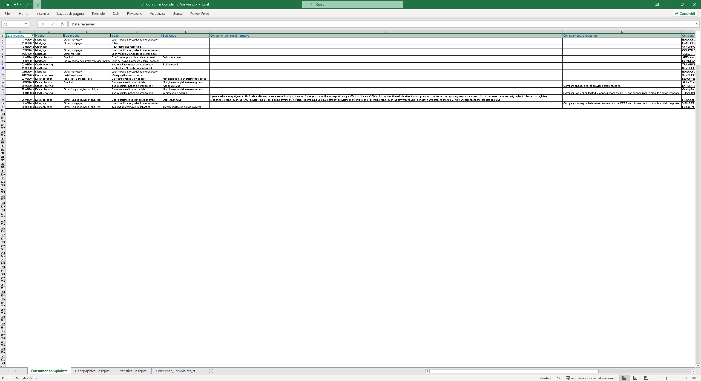
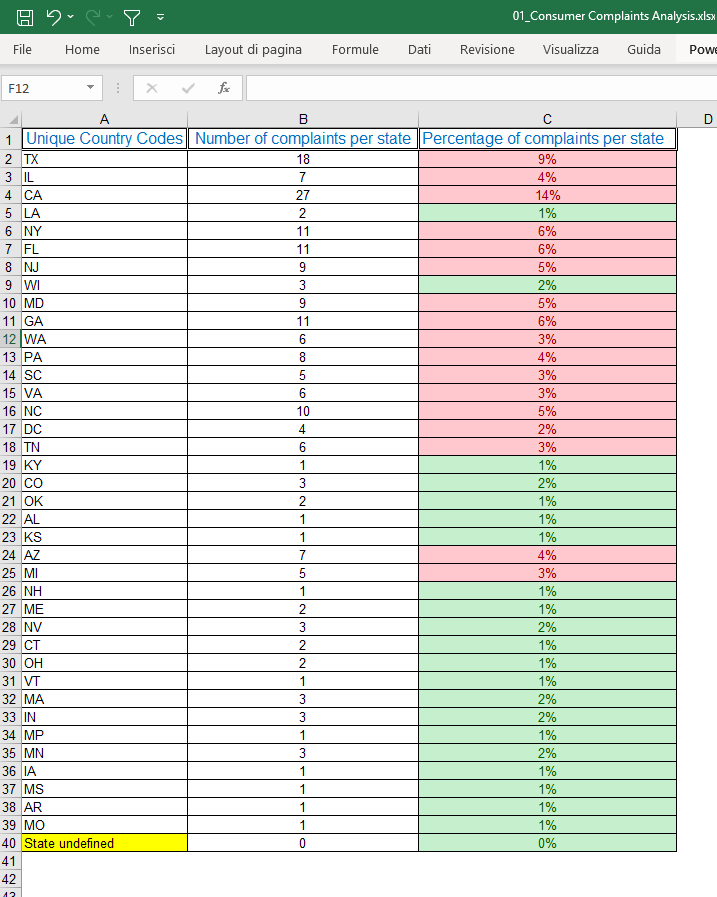
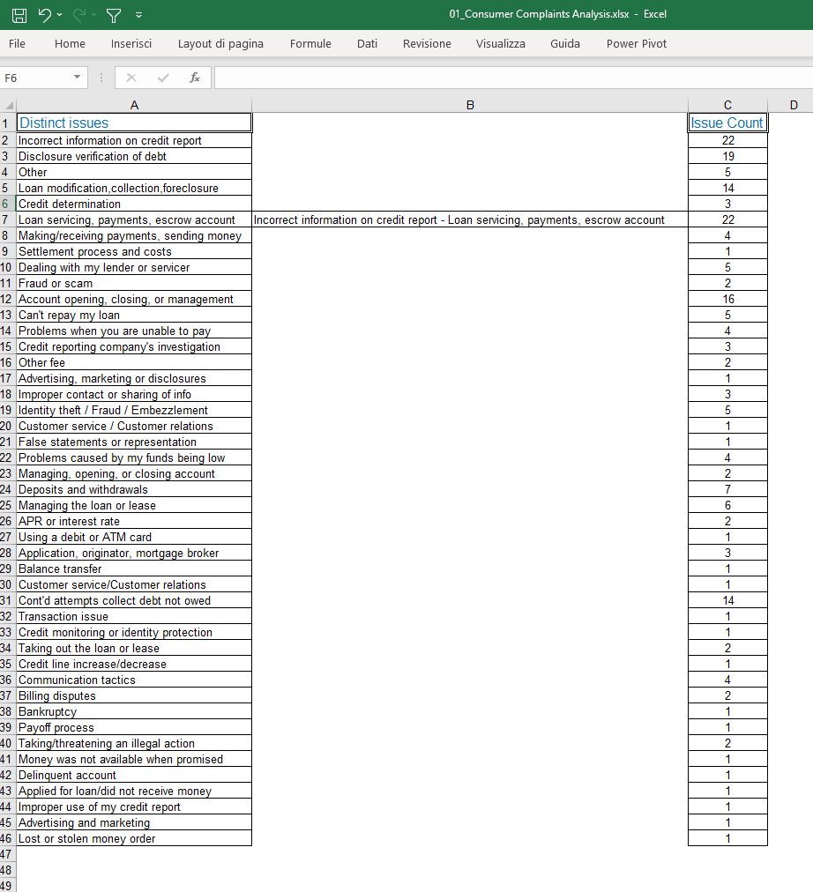

# 📊 Consumer Complaints Analysis
## 📌 Project Overview
This project was developed for FinServ Solutions, a company specializing in software solutions for customer complaint management in the financial services industry.

The objective was to restructure and enhance an existing Excel spreadsheet used to manage consumer complaints, improving data accessibility, analytical capabilities, and decision-making processes.

The project focuses on transforming raw complaint data into a more organized and informative reporting tool through data organization, statistical analysis, geographical insights, and conditional formatting.

## 🗂️ Dataset
**Source:** 02_customers_complaints_assignment

**Period examined:** From 2012 to 2017

## 🎯 Business Objectives
The main objectives of the project were:

- Improve the readability and organization of consumer complaint data.
- Facilitate geographical analysis by identifying the states with the highest number of complaints.
- Provide statistical insights into the most frequent complaint categories.
- Improve the monitoring of complaint processing times.
- Support faster and more informed decision-making through filtering and data visualization.

## 🛠️ Tools & Techniques
- Microsoft Excel
- Data Organization and Formatting
- Excel Formulas and Functions
- COUNTIF (CONTA.SE)
- MODE (Statistical Analysis)
- Conditional Formatting
- Date Calculations
- Data Filtering
- Geographical Analysis

## 📂 Project Structure
The Excel workbook was reorganized into three dedicated worksheets.

## 1. Consumer Complaints
The main worksheet contains the original consumer complaint dataset, reorganized to improve readability and usability.

Key modifications:

- Standardized table formatting and header styling.
- Applied consistent date formatting (DD/MM/YY).
- Sorted records by Complaint ID in ascending order.
- Added a calculated column to measure the number of days between complaint receipt and submission to the company.
- Applied a date filter to display complaints received before August 8, 2016.
  
## 2. Geographical Insights
This worksheet provides a geographical overview of consumer complaints across different US states.

Key features:

- Identified all distinct state abbreviations in the dataset.
- Calculated the total number of complaints per state using the COUNTIF function.
- Calculated the percentage of total complaints represented by each state.
- Applied conditional formatting to highlight states with complaint percentages below 2% in green and percentages of 2% or higher in red.

This analysis makes it easier to identify geographical patterns and areas requiring further attention.

## 3. Statistical Insights
This worksheet focuses on the statistical distribution of complaint categories.

Key features:

- Extracted all distinct complaint issues from the main dataset.
- Counted the occurrences of each complaint category.
- Identified the most frequent complaint category using the MODE function applied to the numerical frequency values.

This provides a quick overview of the most common issues reported by consumers.

## 📊 Key Findings
## Geographical Insights
The geographical analysis identified California (CA) as the state with the highest number of consumer complaints.

 - **State with the highest number of complaints:**  California (CA).
 - **Number of complaints:** 7.
 - **Percentage of total complaints:** 14%.

The percentage distribution was calculated using the total number of complaints as the reference population, with percentages across all states adding up to 100%.

## Statistical Insights
The statistical analysis highlighted the most frequent consumer complaint categories.

 - **Most frequent complaint category (Mode):**
   - Incorrect information on credit report
   - Loan servicing, payments, escrow account.
 - **Other recurring complaint categories:**
   - Disclosure verification of debt.
   - Account opening, closing, or management.

These findings highlight the main areas of concern reported by consumers and can help financial service providers identify recurring issues and potential areas for improvement.

## 📈 Expected Business Value
The revised worksheet is designed to offer a number of operational benefits:

- Improved geographical visibility: easier identification of states with higher complaint volumes.
- More efficient decision-making: faster access to statistical information and recurring complaint categories.
- More effective monitoring of response times: visibility into the time elapsed between the receipt of a complaint and its forwarding to the company.
- Improved data accessibility: a more structured and user-friendly spreadsheet for customer service teams.

## 📁 Repository Contents
- **[01_Consumer_Complaints_Analysis.xlsx](01_Consumer_Complaints_Analysis.xlsx):** Completed Excel project, including three worksheets:
  - Consumer Complaints
  - Geographical Insights
  - Statistical Insights
- **[02_customers_complaints_assignment.xlsx](02_customers_complaints_assignment.xlsx):** Original dataset provided by Profession AI, covering the period 2012–2017.
- **[images](images):** Folder containing screenshots of the three Excel workbook worksheets.

## 💡 Key Takeaways
This project demonstrates how Microsoft Excel can be used not only for data organization but also as a practical analytical tool to support business operations.

By combining data structuring, formulas, statistical functions, geographical analysis, and conditional formatting, the project transforms a basic spreadsheet into a more effective reporting and decision-support tool.

## 🎓 Conclusion
This project demonstrated how Microsoft Excel can be used to transform raw consumer complaint data into a structured and informative analytical tool.

By organizing the data, applying formulas, conducting geographical analysis, and utilizing statistical functions, I developed a workbook that facilitates the identification of recurring complaint types and geographical trends.

The analysis highlighted that California is the state with the highest number of complaints, equal to 14% of the total, also allowing us to identify the most frequent complaint categories.

Overall, this project strengthened my practical skills in data analysis and organization, statistical processing, and data-driven problem-solving using Microsoft Excel.

## 📸 Project Preview
## 1. Consumer Complaints
The main worksheet containing the original dataset, organized and formatted for improved readability and analysis.

## 2. Geographical Insights
Geographical analysis of consumer complaints across US states, including complaint counts and percentages.

## 3. Statistical Insights
Statistical analysis of complaint categories, including the identification of the most frequent issue.

## 📬 Contact
- **Silvia Venturini**
- [LinkedIn](https://www.linkedin.com/in/silvia-venturini92/)
- **Email:** silvia.venturini92@hotmail.com
